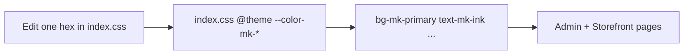

# MineKart — Tailwind Theme Variables (Verification Doc)

> **Status:** Implemented — tokens live in `frontend/src/index.css`.  
> **Goal:** Define colors once; change the whole UI by editing one place.  
> **Pattern:** Same as msv-pvt — Tailwind v4 `@theme inline` → utilities like `bg-mk-primary` (no more `bg-[#A51D26]`).  
> **Helper scripts:** `frontend/scripts/apply-theme-tokens.mjs`, `apply-theme-nearest.mjs` (already run).

---

## 1. Overview

Today almost every page uses **hardcoded hex** in Tailwind arbitrary values, e.g. `bg-[#A51D26]`, `text-[#292725]`, `border-[#E3DED6]`.

| Today | After |
|-------|--------|
| `bg-[#A51D26]` | `bg-mk-primary` |
| `text-[#8E181F]` | `text-mk-primary-hover` |
| `border-[#E3DED6]` | `border-mk-border` |
| `bg-[#F8F6F2]` | `bg-mk-surface` |
| Change brand red | Edit **one** CSS variable → whole app updates |

**Single source of truth:** [`frontend/src/index.css`](../frontend/src/index.css) (already Tailwind v4 — same stack as msv-pvt).



---

## 2. How msv-pvt does it (reference)

File: `msv-pvt/.../globals.css`

```css
@theme inline {
  --color-msv-primary: #344c63;
  --color-msv-danger: #ef4444;
  /* ... */
}
```

Usage: `bg-msv-primary`, `text-msv-danger`, `border-msv-muted/20`.

MineKart will mirror this with prefix **`mk`** (MineKart), not `msv`.

---

## 3. Proposed token set

Values below are taken from the **most-used hex codes** already in the app (frequency scan of `frontend/src`). Adjust any hex in this table during review — implementation will use whatever you approve.

### 3.1 Brand / primary (storefront + CTAs)

| Token | CSS variable | Proposed value | Replaces (examples) | Use |
|-------|--------------|----------------|---------------------|-----|
| `mk-primary` | `--color-mk-primary` | `#A51D26` | `#A51D26` | Main brand / primary buttons |
| `mk-primary-hover` | `--color-mk-primary-hover` | `#8E181F` | `#8E181F`, `#9D2932` | Hover / active brand |
| `mk-primary-deep` | `--color-mk-primary-deep` | `#7D171C` | `#7D171C` | Gradients / strong accent |
| `mk-primary-soft` | `--color-mk-primary-soft` | `#F7EEE7` | `#F7EEE7` | Soft brand background |
| `mk-accent` | `--color-mk-accent` | `#D4A373` | `#D4A373`, `#B87935` | Warm accent (decor, highlights) |

### 3.2 Ink / text

| Token | CSS variable | Proposed value | Replaces | Use |
|-------|--------------|----------------|----------|-----|
| `mk-ink` | `--color-mk-ink` | `#351C18` | `#351C18`, `#493631` | Strong headings (storefront) |
| `mk-ink-admin` | `--color-mk-ink-admin` | `#292725` | `#292725`, `#3F3A35` | Admin headings / body strong |
| `mk-muted` | `--color-mk-muted` | `#806C63` | `#806C63`, `#9A857B`, `#67544D` | Secondary text (storefront) |
| `mk-muted-admin` | `--color-mk-muted-admin` | `#6F6A64` | `#6F6A64`, `#6B6258` (text) | Admin secondary text |
| `mk-subtle` | `--color-mk-subtle` | `#99938B` | `#99938B`, `#999999`, `#958C84` | Hints, labels, placeholders |

### 3.3 Surfaces / borders

| Token | CSS variable | Proposed value | Replaces | Use |
|-------|--------------|----------------|----------|-----|
| `mk-bg` | `--color-mk-bg` | `#FBF7F2` | `#FBF7F2`, `#FBFAF7` | Page background (storefront) |
| `mk-bg-admin` | `--color-mk-bg-admin` | `#F8F6F2` | `#F8F6F2` | Admin page / panel bg |
| `mk-card` | `--color-mk-card` | `#FFFDFC` | `#FFFDFC`, `#FFFCFA` | Cards / panels |
| `mk-surface` | `--color-mk-surface` | `#F1EEE8` | `#F1EEE8`, `#EEEAE4`, `#F1E7E0` | Soft surface / icon wells |
| `mk-border` | `--color-mk-border` | `#E8DDD4` | `#E8DDD4`, `#E2D5CC` | Storefront borders |
| `mk-border-admin` | `--color-mk-border-admin` | `#E3DED6` | `#E3DED6` | Admin borders |

### 3.4 Admin chrome (buttons / sidebar weight)

| Token | CSS variable | Proposed value | Replaces | Use |
|-------|--------------|----------------|----------|-----|
| `mk-admin` | `--color-mk-admin` | `#6B6258` | `#6B6258`, `#5D554C` | Admin primary button / chrome |
| `mk-admin-hover` | `--color-mk-admin-hover` | `#5D554C` | `#5D554C`, `#5a534a` | Admin button hover |

### 3.5 Semantic status

| Token | CSS variable | Proposed value | Replaces | Use |
|-------|--------------|----------------|----------|-----|
| `mk-success` | `--color-mk-success` | `#3E8B62` | `#3E8B62`, `#5E6C55` | Success / delivered |
| `mk-success-soft` | `--color-mk-success-soft` | `#EAEDE7` | `#EAEDE7` | Success badge bg |
| `mk-danger` | `--color-mk-danger` | `#A44A3F` | `#A44A3F` | Delete / error / cancelled |
| `mk-danger-soft` | `--color-mk-danger-soft` | `#F1E7E5` | `#F1E7E5` | Danger badge bg |
| `mk-warning` | `--color-mk-warning` | `#8A6A3D` | `#8A6A3D`, `#B87935` | Pending / warning text |
| `mk-warning-soft` | `--color-mk-warning-soft` | `#F1EEE8` | status soft bgs | Warning badge bg |
| `mk-info` | `--color-mk-info` | `#6D5A91` | `#6D5A91` | Info / special status |
| `mk-info-soft` | `--color-mk-info-soft` | `#ECE9F5` | `#ECE9F5` | Info badge bg |

### 3.6 Neutrals (disabled / gray)

| Token | CSS variable | Proposed value | Replaces | Use |
|-------|--------------|----------------|----------|-----|
| `mk-disabled` | `--color-mk-disabled` | `#888888` | `#888888`, `#777777` | Disabled text |
| `mk-disabled-bg` | `--color-mk-disabled-bg` | `#E8E5E2` | `#E8E5E2`, `#D9D9D9`, `#F3F3F3` | Disabled / skeleton |
| `mk-white` | `--color-mk-white` | `#FFFFFF` | `white` / `#fff` where brand-tied | Explicit white token (optional) |

---

## 4. What will be written in `index.css`

```css
@import 'tailwindcss';

@theme inline {
  /* Brand */
  --color-mk-primary: #A51D26;
  --color-mk-primary-hover: #8E181F;
  --color-mk-primary-deep: #7D171C;
  --color-mk-primary-soft: #F7EEE7;
  --color-mk-accent: #D4A373;

  /* Ink */
  --color-mk-ink: #351C18;
  --color-mk-ink-admin: #292725;
  --color-mk-muted: #806C63;
  --color-mk-muted-admin: #6F6A64;
  --color-mk-subtle: #99938B;

  /* Surfaces */
  --color-mk-bg: #FBF7F2;
  --color-mk-bg-admin: #F8F6F2;
  --color-mk-card: #FFFDFC;
  --color-mk-surface: #F1EEE8;
  --color-mk-border: #E8DDD4;
  --color-mk-border-admin: #E3DED6;

  /* Admin chrome */
  --color-mk-admin: #6B6258;
  --color-mk-admin-hover: #5D554C;

  /* Status */
  --color-mk-success: #3E8B62;
  --color-mk-success-soft: #EAEDE7;
  --color-mk-danger: #A44A3F;
  --color-mk-danger-soft: #F1E7E5;
  --color-mk-warning: #8A6A3D;
  --color-mk-warning-soft: #F1EEE8;
  --color-mk-info: #6D5A91;
  --color-mk-info-soft: #ECE9F5;

  /* Disabled */
  --color-mk-disabled: #888888;
  --color-mk-disabled-bg: #E8E5E2;
}
```

After this, Tailwind generates: `bg-mk-primary`, `text-mk-ink`, `border-mk-border-admin`, `hover:bg-mk-primary-hover`, `bg-mk-primary/10`, etc.

Scrollbar rules in the same file will also switch to `var(--color-mk-*)`.

---

## 5. What will change in code (after you approve)

### 5.1 Files to touch (high level)

| Area | Examples | Change type |
|------|----------|-------------|
| Global CSS | `frontend/src/index.css` | Add `@theme` tokens; update scrollbars |
| Admin | `AdminLayout`, `AdminUsers`, `AdminProducts`, `AdminOrders`, forms, … | Replace `bg-[#…]` / `text-[#…]` / `border-[#…]` |
| Storefront | `Header`, `Home`, `Checkout`, `ProductDetail`, … | Same |
| Auth / misc | `LogIn`, `ForgotPassword`, `NotFoundPage` | Same |

No backend changes. No new npm packages (already Tailwind **v4**).

### 5.2 Replacement examples

| Before | After |
|--------|--------|
| `bg-[#A51D26]` | `bg-mk-primary` |
| `hover:bg-[#8E181F]` | `hover:bg-mk-primary-hover` |
| `text-[#351C18]` | `text-mk-ink` |
| `text-[#292725]` | `text-mk-ink-admin` |
| `border-[#E3DED6]` | `border-mk-border-admin` |
| `border-[#E8DDD4]` | `border-mk-border` |
| `bg-[#F8F6F2]` | `bg-mk-bg-admin` |
| `bg-[#6B6258]` | `bg-mk-admin` |
| `text-[#A44A3F]` | `text-mk-danger` |
| `bg-[#F1E7E5]` | `bg-mk-danger-soft` |

### 5.3 Out of scope (keep as-is unless you ask)

- One-off decorative shadows with `rgba(...)` (can map later to token-based shadows)
- Third-party widget colors
- Image assets
- Exact duplicate near-hexes that are intentional gradients (map closest token)

### 5.4 Optional later (not in first pass)

- Shared component classes like msv’s `.msv-btn` → e.g. `.mk-btn` in CSS
- Dark mode theme
- Merging `mk-ink` + `mk-ink-admin` into one if you want a single text color everywhere

---

## 6. Implementation order (after approval)

1. Add `@theme inline` block to `index.css` with approved hex values  
2. Update scrollbar CSS to use `var(--color-mk-*)`  
3. Replace hardcoded colors **admin** pages first (smaller surface, easy to verify)  
4. Replace **storefront** pages  
5. Grep for remaining `#[0-9A-Fa-f]{6}` in `frontend/src` and clean leftovers  

---

## 7. Review checklist — please verify

### Tokens

- [ ] Prefix `mk-` is OK (vs `minekart-` / `mkart-`)
- [ ] Primary brand = `#A51D26` (not `#8E181F` as main)
- [ ] Keep separate **admin** tokens (`mk-admin`, `mk-border-admin`, …) — OK?
- [ ] Or prefer **one** border / ink for admin + storefront?
- [ ] Status colors (success / danger / warning / info) OK?
- [ ] Any hex to add/remove/rename?

### Scope

- [ ] First pass: CSS tokens + replace all common `bg/text/border-[#…]` — OK?
- [ ] Skip optional `.mk-btn` helper classes for now — OK?

### Decisions locked once you approve

| # | Topic | Draft decision |
|---|-------|----------------|
| 1 | Mechanism | Tailwind v4 `@theme inline` in `index.css` (like msv-pvt) |
| 2 | Prefix | `mk-` |
| 3 | Single edit point | Change hex only in `index.css` |
| 4 | Code change | Swap arbitrary hex classes → `*-mk-*` utilities |

---

## 8. Sign-off

| | |
|--|--|
| Reviewed by | Implemented per approval |
| Date | 2026-10-16 |
| Changes requested (token names / hex) | — |
| Approved for implementation | Yes |

**How to retheme:** edit hex values under `@theme inline` in [`frontend/src/index.css`](../frontend/src/index.css) only.
